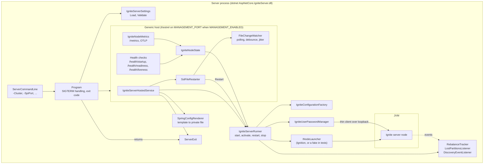
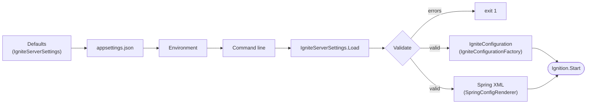
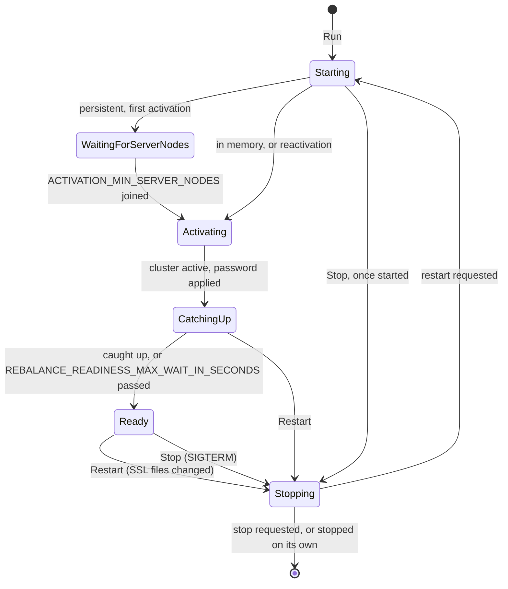
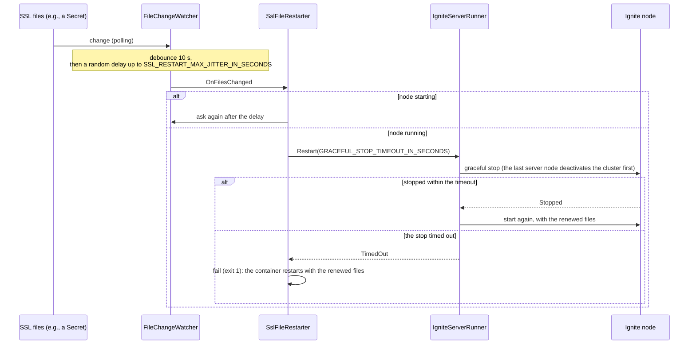
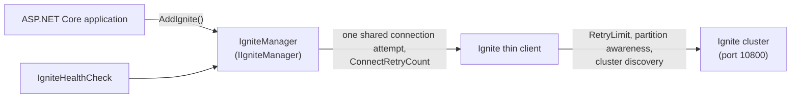

# Architecture

The repository builds two things:

* **The server** (`src/AspNetCore.IgniteServer`, the `aspnetcore.ignite-server` image): a .NET host that runs one
  Apache Ignite 2 server node in its own process (Ignite.NET embedded mode, which starts a JVM in the process). It adds
  what running Ignite in containers needs: settings from the environment, validation, health and metrics endpoints,
  password and certificate rotation, cluster activation, and a graceful stop.
* **The client library** (`src/AspNetCore.Ignite`, the `AspNetCore.Ignite` package): a thin client for ASP.NET Core
  applications, with dependency injection, retries and a health check.

## Server components

* **`Program`** reads the configuration, validates the settings (exit code `1` with every error listed), builds the
  host and returns the exit code of `ServerExit`. It cancels the default SIGTERM handling, so that the host stops the
  node gracefully and the process returns its own exit code.
* **`IgniteServerHostedService`** owns the node for the lifetime of the host: it logs the security warnings, renders the
  Spring configuration, creates the runner, starts the SSL restarts, stops the node with the host, and turns a failure
  into exit code `1` (and a stop that was not graceful into `2`).
* **`IgniteServerRunner`** starts the node, activates its cluster, applies `IGNITE_USER_PASSWORD`, registers the event
  listeners, and restarts or stops the node on request. It starts and stops nodes through `INodeLauncher`, so that its
  lifecycle can be tested without a JVM.
* **`IgniteNodeState`** is what health checks and metrics read: the running node, whether it is started and ready, and
  the caches it rebalances.

## Configuration

* Each source overrides the previous one. A list setting (`CLUSTER_ENDPOINTS`, `SQL_SCHEMAS`) comes from one source,
  the one of the highest priority: the configuration would otherwise merge the lists of several sources index by index.
* The node is configured twice, and Ignite merges both:
  * **.NET** (`IgniteConfigurationFactory`): the default configuration, then a `-ConfigFile` (the properties it sets),
    then the settings: JVM options, memory, storage, timeouts, thread pools, static discovery, authentication, SSL
    between nodes. The .NET configuration wins for the properties it sets.
  * **Spring XML** (`config/spring-config*.xml`, rendered into a private file): what .NET cannot set, the GRACEFUL
    shutdown policy, no environment variables as node attributes, the Kubernetes IP finder, thin client SSL, and the
    `SPRING_EXTRA_*` fragments. Values are inserted at `{{NAME}}` tokens, XML-escaped; Spring expressions (`#{`) are
    refused.
* Discovery is static (`CLUSTER_ENDPOINTS`, or the node itself) unless `USE_TCP_DISCOVERY_STATIC_IP_FINDER=false`
  without endpoints or `SPI_PORT`: the nodes then find each other through the Kubernetes API.

## Node lifecycle

* **Started** (`/health/startup`) once the node has joined the topology, also while its cluster waits for
  `ACTIVATION_MIN_SERVER_NODES`, so that a startup probe does not restart nodes waiting for each other.
* **Ready** (`/health/readiness`) once the cluster is active and, with `READY_WHEN_REBALANCED`, the node has caught up:
  it is in the baseline (which the baseline auto-adjust adds it to) and has not rebalanced for 10 seconds
  (`RebalanceTracker`). A rolling restart therefore moves on only once the restarted node holds its data again. So that
  a node is never unready for good, it is ready anyway `REBALANCE_READINESS_MAX_WAIT_IN_SECONDS` (600 by default) after
  it runs when it is still not in the baseline, and a rebalance that started longer ago than that is ignored.
* **Restart and stop requests** are one field of the runner: a stop always wins over a restart, and a restart is taken
  by the next start. `Restart` returns `Restarting`, `NotRunning` or `TimedOut`.
* **The graceful stop** (Ignite's GRACEFUL shutdown policy) waits until the node's partitions have copies on other
  nodes, within `GRACEFUL_STOP_TIMEOUT_IN_SECONDS`; a node that is still starting is stopped once started, within the
  same timeout. No other node can take over the partitions of the cluster's last
  server node, so that node deactivates the cluster first and stops at once; after a restart, it activates the cluster
  again without waiting for other nodes.
* **A node that stops on its own** (e.g., segmented from the cluster) stops the server with exit code `1`, and its
  container restarts.

### Certificate rotation

### Exit codes

`0` after a graceful stop, `1` after a failure (invalid settings, a failed start, a node that stopped unexpectedly), `2`
after a stop that was not graceful: see [Configuration](configuration.md#exit-codes) for the table. `ServerExit` keeps
the first cause: a failure stops the server, and that stop is then not graceful either.

## Cluster maintenance on the node

* **Activation and baseline** (`IgniteServerRunner`): a persistent cluster records its baseline on its first
  activation, so it waits for `ACTIVATION_MIN_SERVER_NODES`. The baseline then follows the topology after
  `BASELINE_AUTO_ADJUST_TIMEOUT_IN_SECONDS` (5 minutes with persistence, so that a restarted node returns with its data;
  30 seconds without).
* **Password** (`IgniteUserPasswordManager`): the node connects to itself as a thin client over loopback (never to other
  nodes, which would receive the password too) and runs `ALTER USER` through a temporary cache of its own. It tries the
  most likely current password first (the default one on a new cluster, `IGNITE_USER_PREVIOUS_PASSWORD` otherwise), and
  a password another node applied first counts as applied.
* **Lost partitions** (`LostPartitionsListener`): every node logs and remembers the caches that lost partitions; the
  oldest server node resets them, once per batch of events and again on every topology change. A persistent cluster
  waits for a node that owns them to return; an in-memory one drops the departed nodes from the baseline first, and that
  data is gone.

## Client library

* `IgniteManager` connects on first use, not when it is resolved. Concurrent callers share one connection attempt, and
  a failed attempt is retried by the next call.
* Retries happen at three levels, each for its own failures: the connection (`ConnectRetryCount`), the operations of
  `IgniteManager` once connected (`OperationRetryCount`, transient failures only: a lost connection or a cluster that is
  not active), and the reads of the thin client itself (`RetryLimit`).
* Options come from `ASPNETCORE_IGNITE_*` keys, a configuration section, or code (`AddIgnite(...)`).

## Tests

* **Unit tests** (no Docker, no JVM): settings and validation, configuration and Spring rendering, listeners, metrics,
  and the node lifecycle on the fake nodes of `FakeNodeLauncher`, whose stops a test can hold back.
  `ServerLogTests` checks that the log messages the integration tests wait for still exist.
* **Integration tests** (Docker, Testcontainers): the image itself, with real clusters: authentication, SSL and
  rotation, activation, rebalancing, lost partitions, the management endpoints, the control utility and the exit codes.
* **Chart tests** (CI): the image with its Helm chart in kind.

See [Development](development.md) for how to run them.

## Where to change what

| To change                                     | Look at                                                         |
|-----------------------------------------------|-----------------------------------------------------------------|
| A setting (name, default, validation)         | `IgniteServerSettings*.cs`, then `docs/configuration.md`        |
| How a setting configures the node             | `IgniteConfigurationFactory.cs`, or `config/spring-config*.xml` |
| Start, activation, restart and stop           | `IgniteServerRunner.cs` (tests: `IgniteServerLifecycleTests`)   |
| Host integration, exit codes                  | `IgniteServerHostedService.cs`, `ServerExit.cs`, `Program.cs`   |
| Certificate rotation                          | `SslFileRestarter.cs`, `Utils/FileChangeWatcher.cs`             |
| Health and metrics                            | `Management/`                                                   |
| A log message the integration tests wait for  | the message, and `ServerLog.cs` of the integration tests        |
| The client library                            | `src/AspNetCore.Ignite`, then `docs/client.md`                  |
